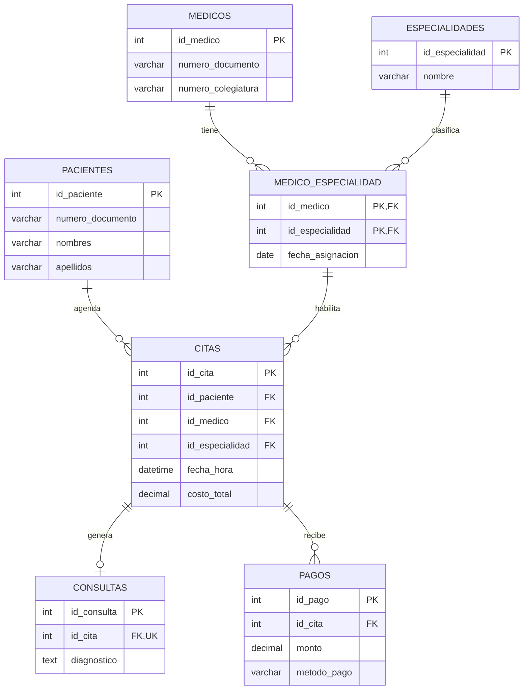

# Modelo relacional de CLINISYS

## Entidades

- **pacientes**: datos personales y de contacto de cada paciente.
- **medicos**: datos personales y número de colegiatura de cada profesional.
- **especialidades**: catálogo de especialidades médicas.
- **medico_especialidad**: tabla intermedia que permite que un médico tenga varias especialidades y que una especialidad pertenezca a varios médicos.
- **citas**: agenda de atención; relaciona paciente, médico y especialidad.
- **consultas**: información de la atención médica realizada; en este diseño se permite una consulta por cita.
- **pagos**: uno o varios abonos asociados a una cita.

## Relaciones

## Decisiones del diseño

1. `medico_especialidad` implementa la relación muchos a muchos entre médicos y especialidades.
2. `citas` utiliza una clave foránea compuesta (`id_medico`, `id_especialidad`) para asegurar que el médico tenga asignada la especialidad elegida.
3. `consultas.id_cita` es UNIQUE para permitir como máximo una consulta registrada por cita.
4. `pagos` permite varios registros para una misma cita, facilitando pagos parciales.
5. Los importes se almacenan en `DECIMAL(10,2)` y se expresan en soles peruanos en la interfaz.
